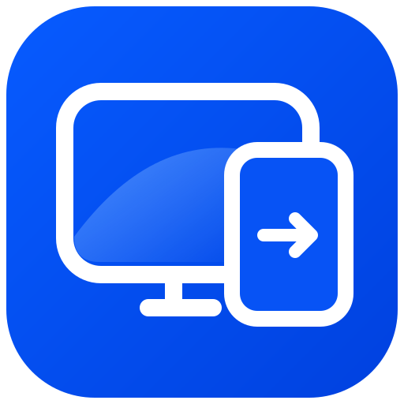
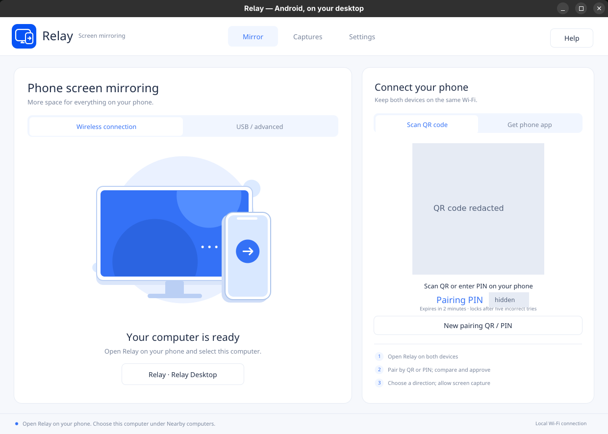
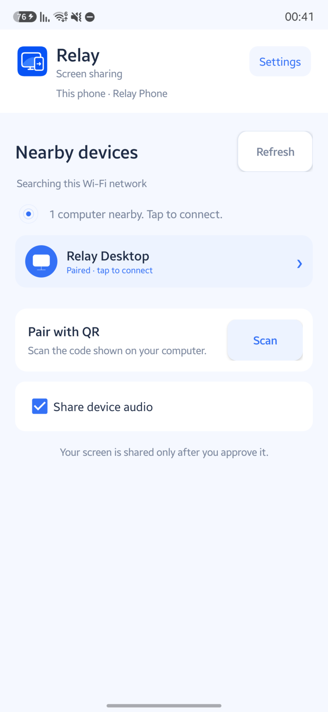
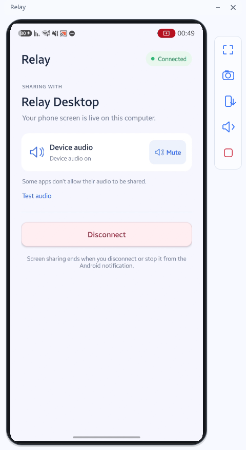
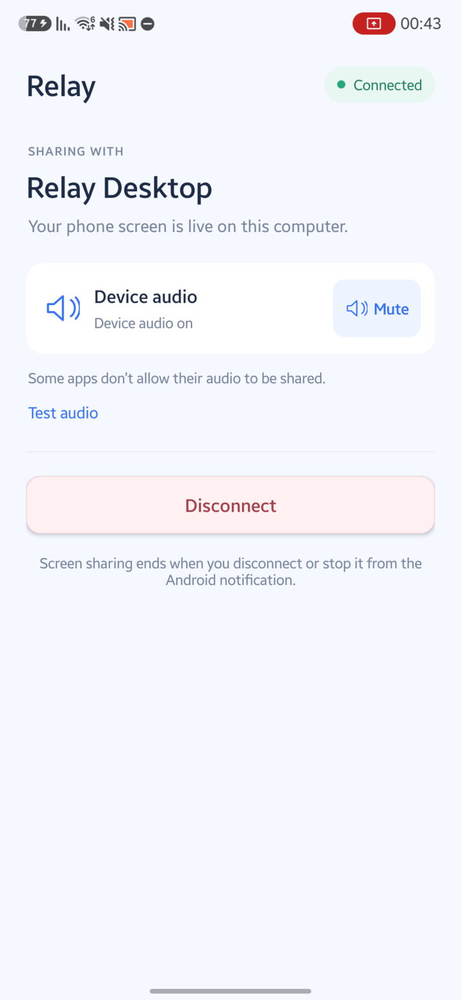

<p align="center"></p>

# Relay

**Your phone and desktop, on the same screen.**

Relay is an experimental Linux desktop app and Android companion for local screen mirroring. The desktop is written in Rust; the companion uses Android's screen-capture and media APIs.

**First public pre-release: [v0.1.0-alpha.1](https://github.com/avihaytr/relay-source/releases/tag/v0.1.0-alpha.1).** It is experimental, not stable. Original approved code is licensed under MPL-2.0. The 13 identified icon files have separate [MIT/Expat copyright permission](ARTWORK_LICENSE.md), version 1.0, and [product-identity policy](BRANDING.md) v1.1, both adopted effective 2026-11-19. These grants do not assert exclusive ownership or third-party clearance. See [licensing scope](LICENSING.md).

## Screenshots

Real Relay captures from Fedora Linux and Android, using public-safe device labels.

<table>
  <tr>
    <td align="center" valign="top"><strong>Linux · discovery</strong><br><br><sub>Full desktop window; QR and PIN visibly redacted.</sub></td>
    <td align="center" valign="top"><strong>Android · nearby devices</strong><br></td>
  </tr>
  <tr>
    <td align="center" valign="top"><strong>Linux · live phone mirroring</strong><br><br><sub>Full live viewer and native phone frame.</sub></td>
    <td align="center" valign="top"><strong>Android · sharing controls</strong><br></td>
  </tr>
</table>

Full frames and nonsensitive status bars are retained following owner review. Desktop QR/PIN values are visibly redacted. Images are genuine application captures, not mockups; no QR/PIN, personal IP, private device name, notification or unrelated screen content is included. Screenshot review details: [screenshots/README.md](screenshots/README.md).

## Preview status

`v0.1.0-alpha.1` is available as a public **pre-release**. Download the [signed Android APK](https://github.com/avihaytr/relay-source/releases/download/v0.1.0-alpha.1/relay-0.1.0-alpha.1-android.apk) or the [unsigned Fedora 43 x86_64 RPM](https://github.com/avihaytr/relay-source/releases/download/v0.1.0-alpha.1/relay-0.1.0.alpha.1-1.fc43.x86_64.rpm). See the [release page](https://github.com/avihaytr/relay-source/releases/tag/v0.1.0-alpha.1), [installation instructions](https://github.com/avihaytr/relay-source/releases/download/v0.1.0-alpha.1/INSTALL.md), and [SHA256SUMS](https://github.com/avihaytr/relay-source/releases/download/v0.1.0-alpha.1/SHA256SUMS). Fedora 43 x86_64 with GNOME/Wayland is the only validated Linux target; other configurations have limited testing. Quality profiles are targets, not guarantees of displayed FPS.

## Supported features

- Phone → PC sharing without Android developer options, including supported device playback audio and mute controls.
- PC → phone view-only sharing through Fedora/Linux's screen/window permission picker. Desktop audio is not sent in this direction.
- Nearby Wi-Fi discovery, first pairing with QR or six-digit PIN and explicit approval, remembered cryptographic device identities, Forget Device, and optional approval for every session.
- Editable device names, quality profiles targeting 720p30, 720p60 and 1080p60, portrait/landscape display, fullscreen and screenshots.
- Optional advanced ADB/scrcpy mode for features such as recording and device control. This mode requires Android developer/debugging setup; normal companion sharing does not.

Tested on Fedora 43/GNOME Wayland and one Android handset. Other Linux desktops, portal backends and Android devices need broader testing. Windows/macOS builds are not supported by the current Unix-specific implementation.

## Linux desktop build

Use a modern Rust/Cargo toolchain supporting Rust 2024, a C compiler, pkg-config, clang/libclang, FFmpeg **7.x development libraries** with H.264 decoding, and ALSA development headers. The checked environment uses Rust 1.99.0 and FFmpeg 7.1.5; this is a tested setup, not a declared minimum Rust version or a guarantee for newer FFmpeg ABIs.

Runtime requirements: a Vulkan-capable graphics driver, OpenSSL CLI, Avahi tools, and a working local network. PC → phone additionally needs Python 3/PyGObject, GStreamer, PipeWire, and an XDG ScreenCast portal/backend. GNOME's backend is used here; install the appropriate backend for your desktop.

On the tested Fedora setup, supporting packages include:

```sh
sudo dnf install rust cargo gcc pkgconf-pkg-config clang clang-libs \
  alsa-lib-devel openssl avahi-tools python3-gobject \
  gstreamer1 gstreamer1-plugins-base gstreamer1-plugins-bad-free \
  pipewire-gstreamer xdg-desktop-portal xdg-desktop-portal-gnome
```

Separately install a compatible `ffmpeg-devel`/FFmpeg 7 stack with H.264 decoding and the package providing `x264enc` (`gstreamer1-plugins-ugly` on the tested machine). These codec packages may require a separately configured distribution repository such as RPM Fusion. This README does not configure third-party repositories or recommend removing conflicting packages automatically. Package availability and FFmpeg major versions vary with the Fedora release.

Check the actual installation before building:

```sh
pkg-config --modversion libavcodec libavformat libavutil libswscale alsa
python3 -c 'import gi; gi.require_version("Gst", "1.0"); from gi.repository import Gst'
gst-inspect-1.0 pipewiresrc
gst-inspect-1.0 x264enc
gst-inspect-1.0 h264parse
```

The pipeline also needs queue, videoconvert, videoscale, videorate and appsink. For advanced mode, install your distribution's `adb` and `scrcpy` separately.

```sh
cargo build --locked --release
cargo test --locked
./target/release/relay --connect-phone
```

Settings are stored under `$XDG_CONFIG_HOME/relay` (default `$HOME/.config/relay`); captures default to `$XDG_DATA_HOME/relay/captures` (default `$HOME/.local/share/relay/captures`). Builds no longer write settings into the source/install directory. Existing saved trust keeps its established location. See [candidate installation](packaging/INSTALL.md).

## Android build

Use a JDK (tested with JDK 21), Android SDK platform **35**, and build-tools **35.0.0**. Add the SDK's platform-tools to PATH for `adb`. Set `ANDROID_HOME` when the SDK is not at `$HOME/Android/Sdk`.

```sh
export ANDROID_HOME="$HOME/Android/Sdk"
bash android/build.sh
# Optional: install your own local build on your device.
adb install -r android/relay.apk
```

This uses javac, d8 and aapt2 directly; Gradle is not required. ZXing Core 3.5.3 is vendored with Apache-2.0 license/NOTICE; the build checks packaged notices. Minimum Android API is 26 (Android 8). Device playback-audio capture requires Android 10+ and an app that allows capture; microphone, protected and communication audio are not supported by this path.

The script creates an ignored **local development keystore** with a publicly known development password. This is not a release signing setup or a secret shipped in Git. Never publish the key. Back up your own local key privately for upgrade continuity; a different signing identity cannot replace an installed APK without the usual Android signing constraints. Do not use this setup for official releases.

## Pair and share

1. Connect both devices to the same reachable local Wi-Fi and open Relay on each.
2. On the phone, select the computer and pair using the PC's QR or six-digit PIN. For PIN pairing, compare the verification code on both screens. Confirm on the phone and approve the new-device popup on the PC. Pairing itself starts no media capture.
3. Choose a direction. Phone → PC requires Android MediaProjection consent. PC → phone requires choosing a screen/window and clicking Share in the Linux portal. Session approval may also be required by your settings.
4. Stop from either app. Remembered devices authenticate using their stored keys and fresh session credentials; they do not bypass OS capture consent. Forget Device revokes local trust and requires pairing again.

Discovery is unauthenticated and conveys no authorization secrets or trusted certificate fingerprint. Protocol 6 uses verified pairing, pinned TLS and signed reconnect challenges. An unreachable network cannot be fixed by accepting an unverified certificate. There is no HTTP APK download endpoint; transfer your verified local APK independently. See [security limits](SECURITY.md).

## Checks

```sh
cargo test --locked
python3 tools/check_licenses.py
bash android/build.sh
bash android/tests/device/build.sh
```

The last command builds the local instrumentation APK after the main Android build; it does not install or run it. Its storage tests require explicit device-test setup and can alter the app's trust state; do not run them against personal pairing data without reviewing the test.

The JVM-only protocol checks require no Android device:

```sh
mkdir -p /tmp/relay-java-tests
javac --release 8 -d /tmp/relay-java-tests \
  android/src/app/relay/companion/IdentityProof.java \
  android/tests/IdentityProofTest.java
java -cp /tmp/relay-java-tests IdentityProofTest
```

The normally ignored Rust real-portal test creates/closes sessions but selects no source and captures no screen:

```sh
cargo test --locked pc_share::tests::repeated_real_portal_sessions_close_their_connections \
  -- --ignored --test-threads=1
```

## Known limitations

Discovery and router/driver reachability need wider coverage. Media is single-session, local-network only; there are no accounts or internet relay. Quality profiles are requests, **not guaranteed fresh-frame or displayed FPS**. No remote control or desktop audio is provided in PC → phone mode. Portal-service restart and driver-hang recovery are not fully qualified. The production portal lifecycle fix was tested for repeated sessions, cancellation and timeout.

The **LGPL FFmpeg / OpenH264 / VA-API prototype is experimental and not production-ready**. It is not selected by the normal build. Measurements found duplicate-frame inflation and sustained 1080p60 limitations. The experimental scripts and private measurements are not part of this source snapshot.

## Source licensing and binary distribution

The standard MPL-2.0 license applies to the approved source and explicitly identified test data, without an Exhibit B incompatibility restriction. **It does not blanket-license this tree's icons, fonts, dependencies or third-party legal texts.** Preserve [LICENSE](LICENSE), [exact scope](LICENSING.md), [third-party notices](THIRD_PARTY_NOTICES.md), and the [fixture provenance](tests/fixtures/README.md).

The current Linux build links to a **GPLv3-or-later-enabled FFmpeg** stack and loads **GPL x264** through GStreamer. An MPL source license does not make that binary LGPL-only or remove combined-work/GPL obligations. A subprocess boundary is not an automatic exemption. Publishing Relay source with dependency instructions is different from distributing those compiled components. The v0.1.0-alpha.1 release provides matching source, dependency materials, notices and checksums; the Fedora RPM is unsigned. See its [release notes](https://github.com/avihaytr/relay-source/releases/tag/v0.1.0-alpha.1) for scope and limitations.

Relay is independent of Apowersoft, ApowerMirror and LetsView. Functional inspiration does not establish copying, and this statement is not trademark or legal clearance. See [contributing](CONTRIBUTING.md); report sensitive issues using [SECURITY.md](SECURITY.md).
